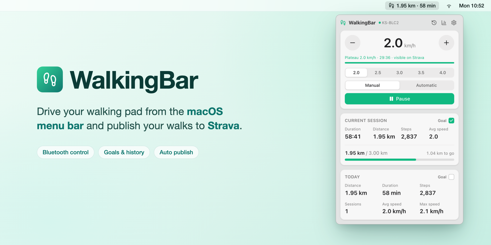
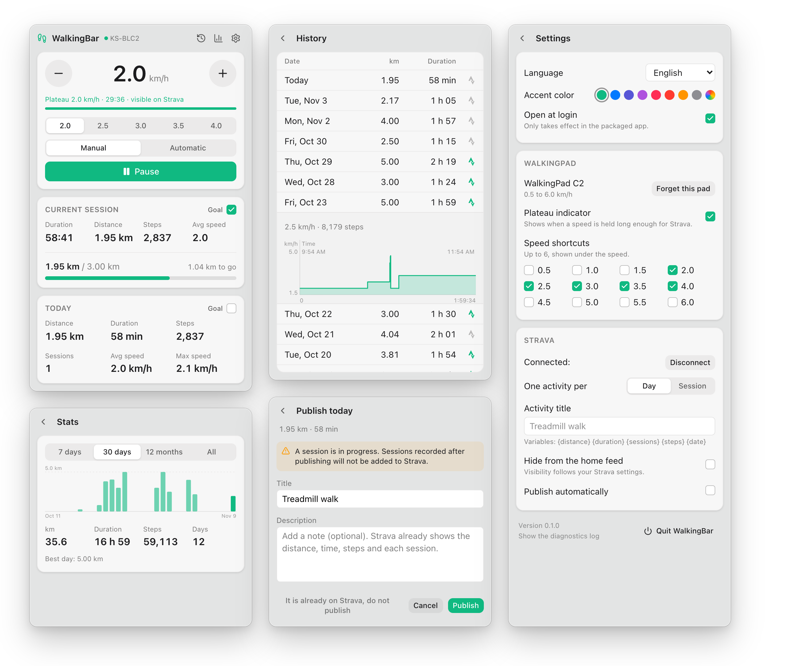

# WalkingBar



WalkingBar is an unofficial macOS menu bar app for your WalkingPad. It drives a KingSmith pad over Bluetooth LE, records every session locally and publishes your walks to Strava, one activity per day or per session.

> This project is not affiliated with or endorsed by KingSmith, Xiaomi or Strava. WalkingPad and Strava are trademarks of their respective owners.
>
> It has only been tested on a WalkingPad C2 and on Apple Silicon. Other models with the KingSmith Bluetooth service should work, and reports are welcome.



## Features

- WalkingPad control from the macOS menu bar
- Global keyboard shortcuts to start, pause and change the speed
- Live stats next to the icon
- Custom speed shortcuts
- Distance and time goals
- History with speed charts, and CSV export
- Walking stats (distance, time, steps, calories) and a regularity heatmap
- Strava publication (manual or automatic)
- English, French, Spanish, Italian, German and Dutch

## Install

WalkingBar needs macOS on Apple Silicon.

1. Download the DMG from the [latest release](https://github.com/cedricdelpoux/walkingpad-menu-bar/releases/latest) and drag WalkingBar to Applications.
2. Open it once. The app is not signed with an Apple Developer ID, so macOS blocks it the first time. Open **System Settings › Privacy & Security** and click **Open Anyway**.
3. [Connect your Strava application](docs/strava.md#configure-the-strava-application) to publish your walks.

## Build from source

Building needs Node.js 24 with npm 11.

```sh
git clone https://github.com/cedricdelpoux/walkingpad-menu-bar.git
cd walkingpad-menu-bar
npm install
npm run dist
```

The DMG is written to `release/`. See [Build](docs/build.md) to sign it with a stable local identity.

## Documentation

- [Strava](docs/strava.md): set up your application and publish your walks
- [Build](docs/build.md): package the app and sign it
- [Development](docs/development.md): commands, debugging, project layout and translations
- [The pad](docs/pad.md): Bluetooth protocol and test scripts
- [How sessions are recorded](docs/sessions.md)

## License

[MIT](LICENSE)
